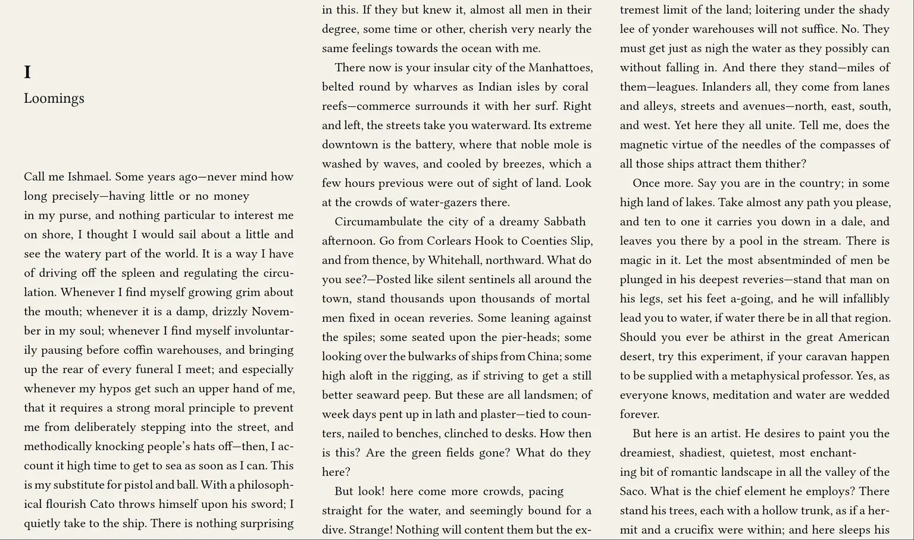
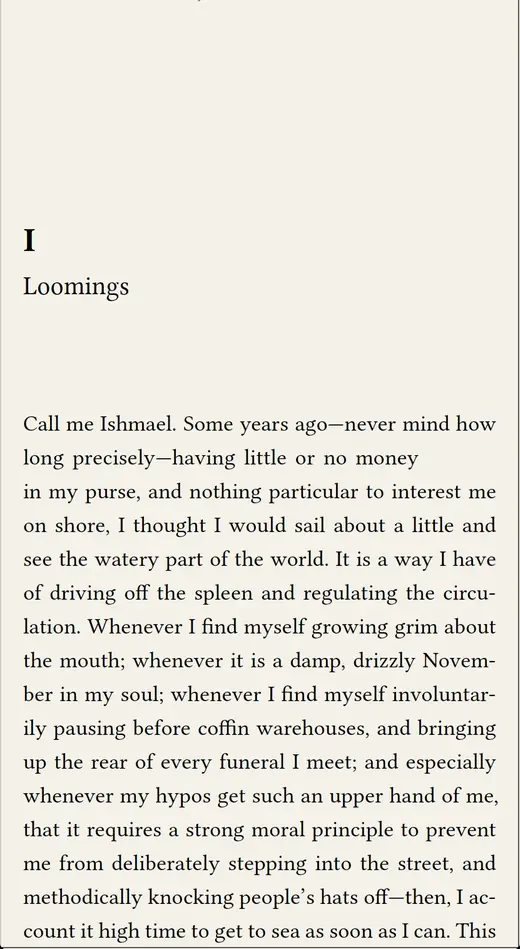
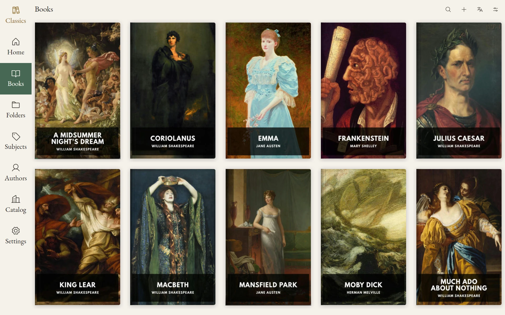
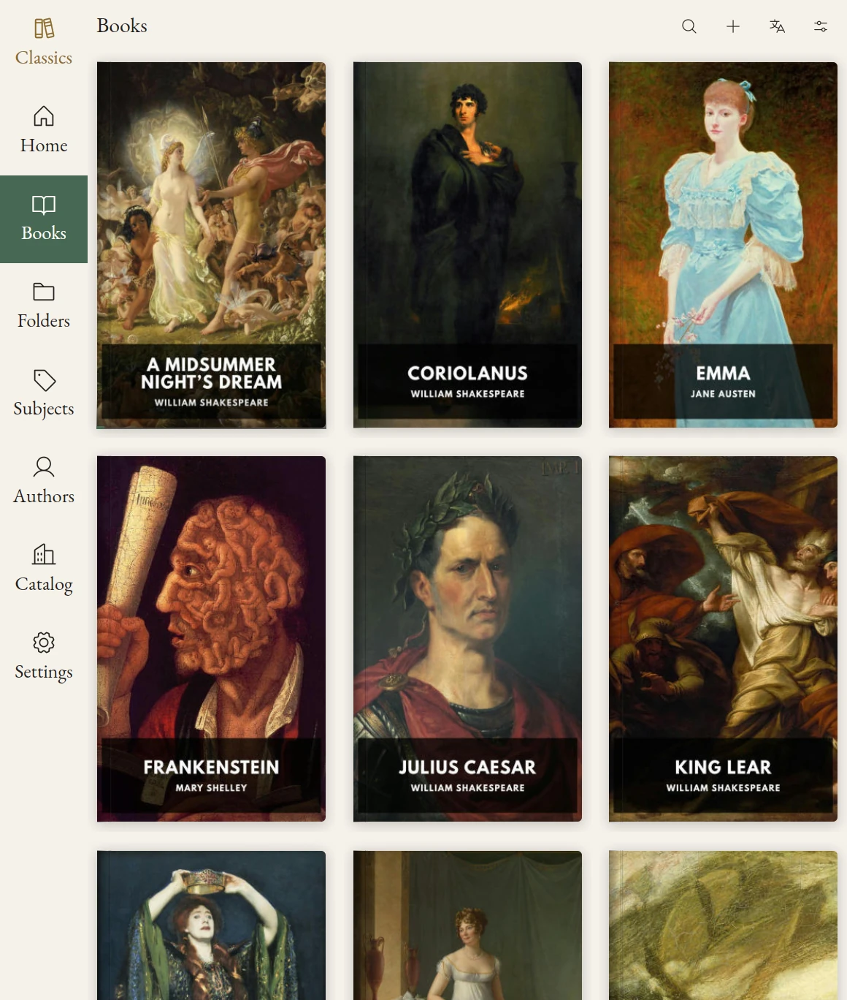
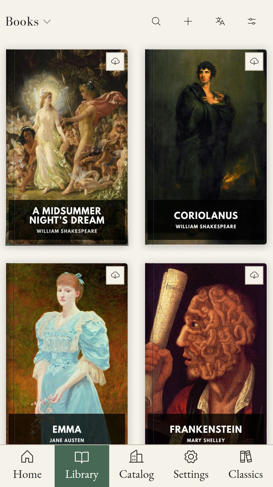
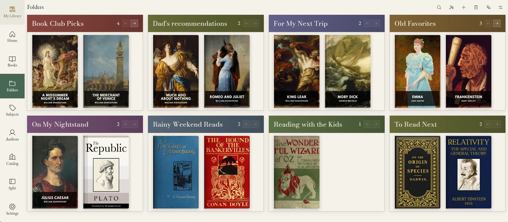
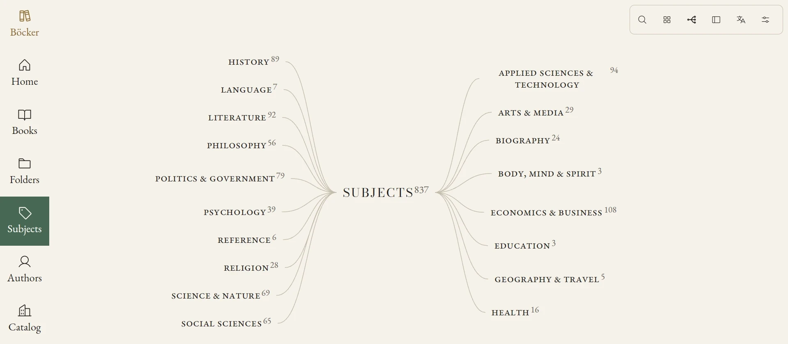
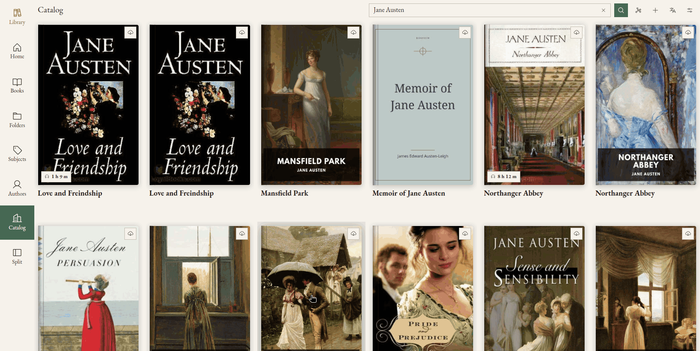
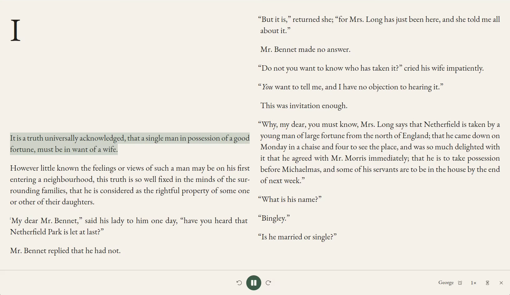

# [Bokheim](https://bokheim.se/)

One library for all your books on all your devices.

[Download Bokheim](https://github.com/JohanAnderssonOstling/bokheim-release/releases/latest) · [Open in browser](https://app.bokheim.se)

[Linux](https://github.com/JohanAnderssonOstling/bokheim-release/releases/latest/download/Bokheim-x86_64.AppImage) · [Windows installer](https://github.com/JohanAnderssonOstling/bokheim-release/releases/latest/download/Bokheim-Windows-x86_64-Setup.exe) · [Windows standalone](https://github.com/JohanAnderssonOstling/bokheim-release/releases/latest/download/Bokheim-Windows-x86_64-Standalone.exe) · [Android](https://github.com/JohanAnderssonOstling/bokheim-release/releases/latest/download/Bokheim-Android-arm64.apk) · [macOS](https://github.com/JohanAnderssonOstling/bokheim-release/releases/latest/download/Bokheim-macOS-universal.dmg)

## Kobo installer

[Linux](https://github.com/JohanAnderssonOstling/bokheim-release/releases/latest/download/Bokheim-Kobo-Installer-Linux-x86_64.AppImage) · [Windows](https://github.com/JohanAnderssonOstling/bokheim-release/releases/latest/download/Bokheim-Kobo-Installer-Windows-x86_64.exe)

## Offline first sync

Library data is always available offline and syncs when online

## Seamless cross device reading

Pick up exactly where you left off when you switch between computer, phone or Kobo

## All your books

EPUB, PDF, MOBI, AZW, AZW3, FB2 and CBZ. M4B and MP3.

## Pick up where you left off

With a free account your books, annotations and reading positions are synced automatically.

## One app on every screen

## Keep your folder structure

Existing folder structures are preserved and kept up to date.

## Automatic categorization

Your books are automatically categorized into a subject hierarchy using data embedded in your files and publicly available data.

## Find your next read

Add high quality public domain books from the 5000+ book curated catalog. Explore OPDS catalogs and download from the web with the embedded browser.

## Listen to your books

[George](https://bokheim.se/light/#listen) · [Alba](https://bokheim.se/light/alba/#listen)

[Privacy Policy](https://bokheim.se/light/privacy/) · [Terms of Service](https://bokheim.se/light/terms/) · [Delete your account](https://bokheim.se/light/delete-account/)
